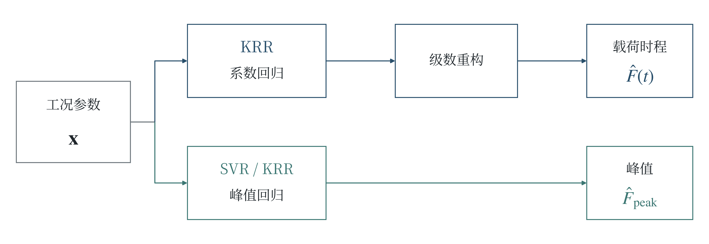

# Sloshing Surrogate Models

基于 OpenFOAM 仿真数据的液体晃荡载荷代理模型，涵盖制动、转弯、变道和坡道工况。项目包含 POD 降阶、载荷回归、独立工况评价及结果可视化程序。

`model/` 提供模型与数据处理源码，`demo/` 使用结果数据生成六幅研究图件。CFD 数据采用 interFoam 求解器计算，仿真算例、完整训练数据及模型权重在本地另行配置。



## 运行示例

推荐 Python 3.12。在项目根目录创建独立环境并安装绘图依赖：

```powershell
py -3.12 -m venv .venv
& ".\.venv\Scripts\python.exe" -m pip install -r requirements.txt
& ".\.venv\Scripts\python.exe" run_demo.py
```

Linux / macOS 可使用 `python3.12 -m venv .venv` 创建环境，随后通过 `.venv/bin/python` 执行安装与运行命令。Windows 环境配置完成后，也可双击 `RUN_DEMO.bat`。

图件输出至 `demo/figures/`，提供 PNG、PDF 和 SVG 格式。绘图入口读取随附 CSV；运行前自动核对数据指纹。颜色、字体和图幅可在 `demo/style.py` 中调整，模型结构图在 `demo/fig03_model_framework.py` 中调整。

## 模型入口

| 任务 | 主要程序 |
| --- | --- |
| 场数据预处理与共享 POD | `export_compact_h5.py`、`build_shared_pod_v3.py` |
| Gram 构建与折内建基评价 | `gram_pod.py`、`kfold_infold.py` |
| POD 系数代理 | `train_podnn.py`、`train_krr.py` |
| 多通道载荷代理 | `p3_load_surrogate.py` |
| 变道力矩代理与独立评价 | `p3_overtaking_v5.py`、`predict_overtaking_v5_offgrid.py`、`evaluate_overtaking_v5_offgrid.py` |

模型程序位于 `model/`，使用该目录作为运行工作目录。训练依赖见 `model/requirements.txt`；各入口参数见对应程序的 `--help`。训练和评价按具体任务准备 HDF5、共享基、Gram、`loads_all.npz` 或模型权重，并保存运行参数及数据划分。各模块依赖同级工具脚本，请保持目录结构。

## 数据与评价

| 数据 | 内容 |
| --- | --- |
| `demo/data/gt_metrics.csv` | 6 个独立载荷工况的逐例评价指标 |
| `demo/data/gt_curves.csv` | 对应工况的 CFD 与预测绘图曲线 |
| `demo/data/validation_*.csv` | 自由液面验证曲线 |
| `demo/data/grade_entry_*.csv` | 坡道瞬态载荷与峰值记录 |
| `demo/data/nested_cv_summary.csv` | 载荷模型交叉验证汇总 |
| `model/data/overtaking_offgrid_manifest.csv` | 16 个独立变道力矩工况的设计配置 |

载荷时程验证与变道力矩评价分别使用各自的工况、变量和统计结果。POD 系数、重构场、载荷时程和峰值指标按任务分别报告。

六个载荷工况的时程预测平均 R² 为 **0.943**，峰值直接回归的平均绝对相对误差为 **9.4%**，逐例结果见 `gt_metrics.csv`。曲线文件每例保留 1000 个绘图点，汇总指标采用 2000 点评价口径。峰值标记表示预测幅值，其显示时刻和符号取自 CFD 参考峰值。

## 字体

绘图使用 [Noto Serif CJK SC](https://github.com/notofonts/noto-cjk)，按 SIL Open Font License 1.1 分发。字体来源和许可保留在 `demo/fonts/`。
